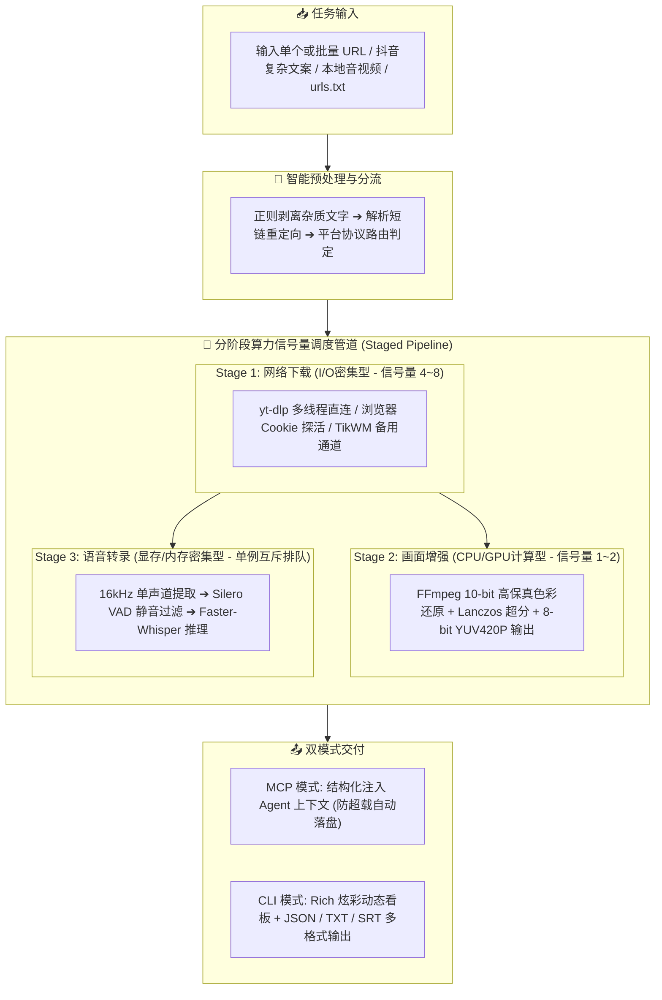

# 🎬 Video Transcription & Enhancement Skill (视频解析、语音转写与画质增强)

<p align="center">
  
  
  
  
  
  
</p>

> **专为现代 AI Agent（Claude Desktop、Cursor、Antigravity、Dify 等）与高阶开发者打造的一站式多平台音视频无感抓取、10-bit 工业级超清画质修复与纯本地高精度语音转写服务。**
>
> 既可作为标准 **FastMCP / Agent Skill** 原生挂载至各类大模型智能体，亦可作为强大的 **多任务高并发 CLI 命令行工具** 独立使用！

---

## 🌟 核心亮点与痛点解决

| 痛点场景 | 传统方式 / 现有工具缺陷 | 本项目解决方案 |
| :--- | :--- | :--- |
| **抖音/快手文案混杂** | 用户复制出整段文字带标题、口令，解析器报错崩溃 | **免预处理清洗**：内置智能正则过滤，直接喂入整段 App 分享文案，秒级抽取纯净 URL 并跟随短链重定向 |
| **API 计费与隐私泄露**| 云端 ASR 按分钟收费昂贵，商业机密或私人音视频泄露 | **100% 纯本地离线推理**：基于 `faster-whisper` (CTranslate2)，支持 CPU / CUDA 硬件加速，零 API 费用 |
| **Whisper 幻觉复读** | 遇到背景音乐、无声或呼吸声时，Whisper 疯狂“复读机” | **幻觉彻底根治**：深度集成 Silero VAD 静音切除，关闭上下文连续推测 (`condition_on_previous_text=False`) |
| **低清/色彩断层视频** | 搬运或转录的视频分辨率低、涂抹感严重、8-bit 色阶断裂 | **10-bit 黄金超清增强**：内部 10-bit 广色域计算管道、BT.709 色彩校正、Lanczos 高保真超分重采样 |
| **并发任务显存溢出** | 批量处理视频时多线程并发推理，瞬间撑爆显存 (CUDA OOM) | **分阶段算力信号量流水线**：I/O 高并发下载 ➔ CPU 并发渲染 ➔ GPU 互斥推理排队，交叠流水线吞吐翻倍 |
| **平台风控与强制登录**| 抖音/B站/TikTok 弹出滑块、验证码或要求登录阻止抓取 | **双浏览器全自动探测 + TikWM 容灾**：自动嗅探 Edge/Chrome 本地 Cookie，TikTok 自动嗅探系统代理并无感回退 |

---

## 🏗️ 架构与流水线调度

本项目设计了 **分阶段算力信号量 (Staged Semaphores)** 并发调度模型，使不同资源消耗类型的任务高效流水线化交叠，杜绝系统假死与显存 OOM：



---

## 🛠️ 前置准备

### 1. 系统底层依赖：FFmpeg

本项目音视频流提取与画质增强高度依赖 `ffmpeg`。请确保系统环境变量 `PATH` 中可直接调用 `ffmpeg`：

- **Windows**:
  1. 下载 [FFmpeg Release Essentials 压缩包](https://www.gyan.dev/ffmpeg/builds/)；
  2. 解压并将内部的 `bin` 目录路径添加至系统的环境变量 `Path` 中；
  3. 打开终端执行 `ffmpeg -version` 验证成功。
- **macOS**:
  ```bash
  brew install ffmpeg
  ```
- **Linux (Ubuntu/Debian)**:
  ```bash
  sudo apt update && sudo apt install -y ffmpeg
  ```

---

## 🚀 快速上手

### 1. 克隆仓库与创建虚拟环境

```bash
# 克隆仓库
git clone https://github.com/luiguouy/video-transcription-skill.git
cd video-transcription-skill

# 创建 Python 虚拟环境 (建议 Python 3.10+)
python -m venv venv

# 激活虚拟环境
# Windows:
venv\Scripts\activate
# Linux/macOS:
# source venv/bin/activate

# 安装依赖
pip install -r requirements.txt
```

### 2. 环境配置 (`.env`)

复制环境配置文件模版：
```bash
cp .env.example .env
```

主要配置项说明：
```ini
# Whisper 模型规格: tiny, base, small, medium, large-v3 (本地推荐 base 或 small，兼顾速度与准确度)
WHISPER_MODEL_SIZE=base

# 计算设备: auto, cuda, cpu (auto 会优先检测显存并选择 cuda)
WHISPER_DEVICE=auto

# 计算精度: GPU 建议 float16，纯 CPU 建议 int8 或 default
WHISPER_COMPUTE_TYPE=default

# 平台 Cookie 兼容策略: "auto" (自动探测 Edge/Chrome/Firefox), "edge", "chrome", 或指定 cookies.txt
COOKIES_FROM_BROWSER=auto
COOKIES_FILE_PATH=./cookies.txt

# 并发调度限制
MAX_CONCURRENT_TASKS=3
MAX_CONCURRENT_DOWNLOADS=4
MAX_CONCURRENT_RENDERS=1
MAX_CONCURRENT_TRANSCRIBES=1
```

---

## 💻 场景实战：CLI 独立使用

`cli.py` 具备开箱即用的 Rich 动态控制台面板与完整的并发调度支持：

### 场景 1：单个视频转录（连贯段落模式，适合提炼文案/写摘要）
直接粘贴整段抖音分享文案或视频链接：
```bash
python cli.py "7.28 01/21 e@b.pm 复制打开抖音，看看【小助手】的作品 https://v.douyin.com/xxx/" --format paragraph
```

### 场景 2：获取精确时间戳切片（适合按时间线剪辑、做字幕）
```bash
python cli.py "https://www.bilibili.com/video/BV1xxxxxx" --format timestamped
```

### 场景 3：本地音视频文件直接转写
直接传入本地 `.mp4`, `.mp3`, `.wav` 等文件绝对或相对路径：
```bash
python cli.py "D:\Videos\interview.mp4" --format paragraph
```

### 场景 4：开启 10-bit 超清画质增强与修复
使用 `--enhance` 开启工业级色彩与细节重采样（输出高质量增强视频与纯净音频）：
```bash
python cli.py "https://www.youtube.com/watch?v=xxxxxx" --enhance --format paragraph
```

### 场景 5：【多任务并发批处理】多链接直接传入
```bash
python cli.py "<链接1>" "<链接2>" "<链接3>" --concurrency 3 --output-dir "batch_results"
```

### 场景 6：【批量导入】从文本文件读取海量链接
准备一个 `urls.txt`，每行一个链接或分享文案：
```bash
python cli.py --file urls.txt --concurrency 4 --output-dir "batch_results"
```

### 场景 7：导出 JSON 结构化数据
```bash
python cli.py "https://www.bilibili.com/video/BV1xxxxxx" --json --output "result.json"
```

---

## 🔌 接入 AI Agent (FastMCP / Skill)

本项目内置标准 MCP (Model Context Protocol) 规范接口，能无缝挂载为 Claude Desktop、Cursor、Antigravity 等智能体的专属工具。

### 1. Claude Desktop 配置

在 Claude Desktop 配置文件（Windows: `%APPDATA%\Claude\claude_desktop_config.json`，macOS: `~/Library/Application Support/Claude/claude_desktop_config.json`）中添加：

```json
{
  "mcpServers": {
    "video-transcriber": {
      "command": "D:\\Antigravity_Workspaces\\videoload_tran\\venv\\Scripts\\python.exe",
      "args": ["D:\\Antigravity_Workspaces\\videoload_tran\\src\\server.py"]
    }
  }
}
```

### 2. Cursor 配置

在 Cursor 中依次打开：`Settings` ➔ `Features` ➔ `MCP` ➔ `Add new MCP server`：
- **Name**: `video-transcriber`
- **Type**: `command`
- **Command**: `D:\Antigravity_Workspaces\videoload_tran\venv\Scripts\python.exe D:\Antigravity_Workspaces\videoload_tran\src\server.py`

### 3. Google Antigravity / Agentic Framework

在智能体配置中引用项目下的 `.agents/skills/video-transcription/SKILL.md`，Agent 即可在对话中自主识别用户发送的各平台视频链接，自动调度并发与转写。

---

## 📂 项目结构

```plaintext
video-transcription-skill/
├── .agents/
│   └── skills/
│       └── video-transcription/
│           └── SKILL.md          # Agent 专属技能描述与 SOP 执行规范
├── src/
│   ├── core/
│   │   ├── cleaner.py            # 正则过滤抖音混杂分享文本与短链解析
│   │   ├── extractor.py          # yt-dlp 核心抓取、TikTok TikWM 回退与代理嗅探
│   │   ├── transcriber.py        # faster-whisper 单例推理引擎与 VAD 配置
│   │   ├── watermark.py          # 10-bit 黄金超清增强与视频渲染管线
│   │   ├── router.py             # 平台策略分流与权限分类
│   │   └── batch_engine.py       # 分阶段信号量并发调度引擎
│   ├── config.py                 # Pydantic 响应式配置读取
│   ├── schemas.py                # 数据模型与输入输出规范
│   └── server.py                 # FastMCP 服务入口
├── tests/                        # 单元测试用例
├── cli.py                        # Rich 动态多任务 CLI 调度入口
├── requirements.txt              # 项目核心生产依赖
├── .env.example                  # 环境变量模版
├── .gitignore                    # 敏感文件/持久化音视频过滤清单
├── LICENSE                       # MIT 开源协议
└── README.md                     # 项目说明文档
```

---

## 🧪 单元测试

进入项目根目录运行核心单元验证：

```bash
# Windows PowerShell
$env:PYTHONPATH="."
.\venv\Scripts\python.exe tests/test_cleaner.py
.\venv\Scripts\python.exe tests/test_schemas.py
```

---

## 🤝 贡献与反馈

欢迎提交 PR 或 Issue！无论是增加新平台解析适配、增强画质算法，还是优化调度性能，我们都非常期待你的参与。

1. Fork 本仓库
2. 创建特性分支 (`git checkout -b feat/AmazingFeature`)
3. 提交更改 (`git commit -m 'feat: Add some AmazingFeature'`)
4. 推送到分支 (`git push origin feat/AmazingFeature`)
5. 提交 Pull Request

---

## 📄 开源许可证

本项目基于 [MIT License](LICENSE) 许可协议开源。
